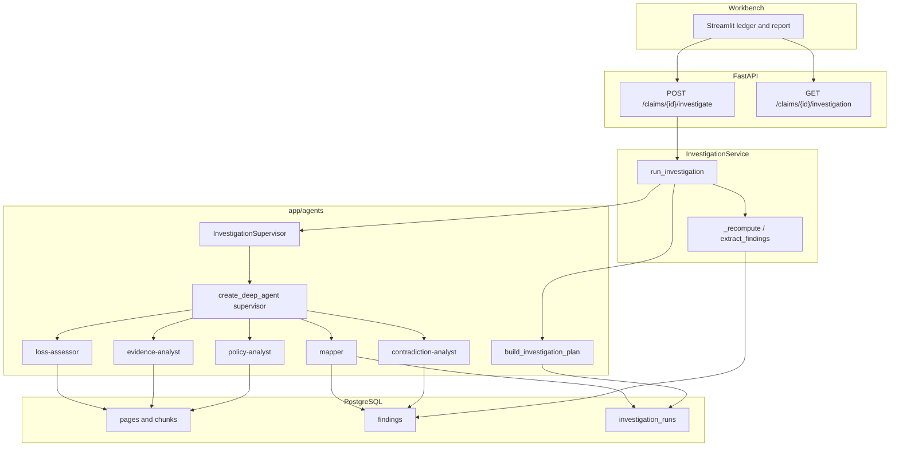
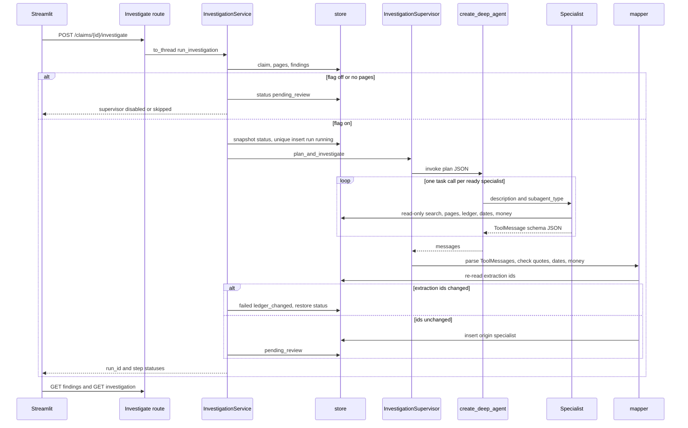
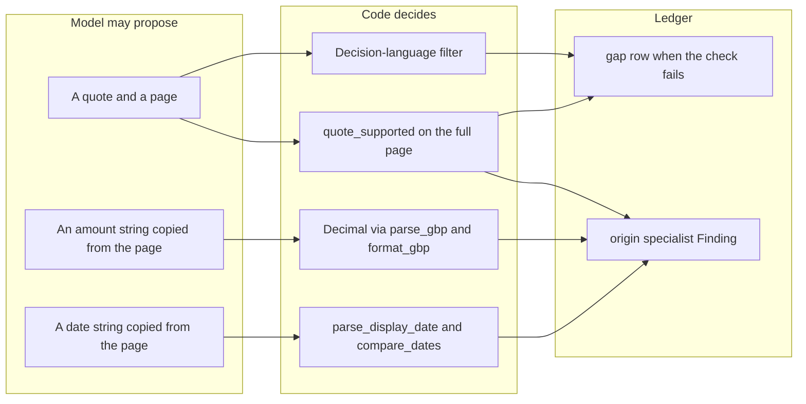

# Phase 2 flow — supervisor, specialists, and the ledger

The investigator asks for a run. Extraction has already written the ledger. The supervisor delegates four read-only specialists. Code checks every quote, date, and amount before a specialist row is stored. The workbench never grants cover, decides fraud, or authorises payment.

`INVESTIGATION_AGENT_ENABLED` defaults to false. With the flag off, `POST /claims/{id}/investigate` only marks the claim `pending_review` and adds `supervisor: disabled`.

## Run path

## One investigate call

## What the code decides

Search still embeds the query with the Phase 1 embedding path. That path is not the chat model, and the `chunks.embedding` column stays `vector(256)`.

A second investigate while a running row is younger than 15 minutes returns HTTP 409. Upload, recompute, and the sample-row action do the same, and they do not delete the ledger. A running row older than 15 minutes is marked `failed` with `error=superseded` in the same transaction as the new insert.

`DeadlineMiddleware` stops the next model call 180 seconds after the run starts. It does not cancel an OpenAI call that has already started. That call is bounded by a 60-second timeout. The route's `asyncio.wait_for` returns HTTP 504 to the browser and does not kill the worker thread. The thread still writes a terminal run status.
